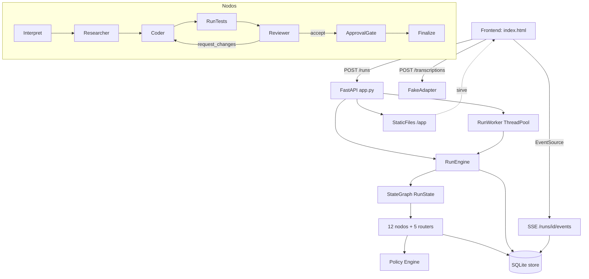

# Auditoría técnica externa — AI Software Engineering System (Proyecto 4)

> **Naturaleza de este documento.** Auditoría **de solo lectura**.
> No se ha modificado, creado, borrado ni renombrado ningún fichero del proyecto.
> No se ha instalado nada, no se ha hecho commit, ni checkout, ni push/pull/fetch.
> No se ha contactado con ningún remoto ni servicio externo.
> Toda afirmación se apoya en un comando ejecutado y su salida, o en una lectura de fichero.
> Las afirmaciones previas del equipo se **re-verificaron de forma independiente**;
> las que no se pudieron verificar se marcan como tales.

Fecha de la auditoría: 2026-10-06
Raíz real auditada: `<PROJECT_ROOT>/proyecto4-ai-swe`
(hay un nivel intermedio: la raíz del repo Git está en `<WORKSPACE>/` y el proyecto vive en `proyecto4-ai-swe/`)

---

## Leyenda de clasificación

| Marca | Significado |
|---|---|
| ✅ | **IMPLEMENTADO Y VERIFICADO** — funciona y se comprobó ejecutándolo |
| 🟡 | **IMPLEMENTACIÓN PARCIAL** — existe y arranca, pero le falta alcance declarado |
| 🔵 | **PLANEADO, NO IMPLEMENTADO** — solo diseño o andamiaje |
| ⚫ | **NO VERIFICADO** — no se pudo comprobar con seguridad |
| 🔴 | **AUSENTE / NO IMPLEMENTADO** — no existe |

---

## 1. Resumen ejecutivo

El proyecto es un **esqueleto ejecutable (fase M1) de un sistema multiagente** para tareas de ingeniería de software, construido sobre **LangGraph + FastAPI + SQLite + Pydantic v2**, con un **frontend real servido en el mismo origen** y **progreso en vivo por SSE**.

Lo que está **de verdad implementado y funciona hoy** (verificado con comandos):

- El sistema **arranca**, acepta una instrucción de texto y devuelve un `run_id` **sin bloquear** (202).
- Ejecuta el grafo de orquestación **en un trabajador** (pool de hilos), publicando **progreso nodo a nodo**.
- El **frontend funciona en un motor de render real** (Chrome headless): 11/11 comprobaciones en verde.
- Toda ejecución termina en **estado terminal explícito** (`MET-13 = 0` verificado por diseño y por mutación).
- **Puerta de aprobación humana real**: pausa (`interrupt`) y reanudación, **aprobación y rechazo** verificados end-to-end.
- **Policy Engine real** con denegar-por-defecto y confinamiento de rutas, con **matriz de permisos como dato**.
- **153 pruebas pasan** y **24/24 mutaciones son cazadas** (re-verificado por el auditor).
- Persistencia en SQLite con **checkpointer de LangGraph**, **registro de eventos persistente** y **reanudación entre procesos** verificada.

Lo que **NO está implementado y el equipo declara**:

- **No hay ningún modelo (LLM) conectado.** Verificado: en `src/` no existe ni una sola llamada a OpenAI/Anthropic/`ChatOpenAI`/litellm/Ollama. El clasificador de intención es un **diccionario de palabras clave**.
- **No hay Coder que genere parches.** El nodo `coder` devuelve un cambio **vacío** de forma deliberada.
- **No hay ejecutor de pruebas.** `run_tests` registra un error tipado en vez de inventar evidencia (decisión de diseño correcta).
- **No hay MCP.** Verificado: cero importaciones de `mcp` en `src/`.
- **No hay prompts.** Verificado: no existe ningún módulo de prompts.
- **No hay autenticación.** Verificado: ninguna ruta HTTP tiene dependencia de auth; cualquiera que alcance la API ve todas las ejecuciones.

**Veredicto de madurez:** el proyecto está en un **M1 sólido y honesto**, con una infraestructura de orquestación, persistencia y verificación de calidad **muy por encima de lo habitual para una fase de esqueleto** — pero el "cerebro" (modelo, agentes que razonan, herramientas que actúan) **todavía no existe**. Es una carcasa excelente esperando su motor.

---

## 2. Objetivo declarado vs. estado actual

| Objetivo declarado (README, `docs/`) | Estado real | Evidencia |
|---|---|---|
| Sistema multiagente (Researcher, Coder, Reviewer, Supervisor) | 🟡 Los **nodos** existen y se ejecutan; **no son agentes** (sin modelo) | `graph/nodes.py`: docstrings "sin modelo en M1" |
| Convertir instrucción en plan verificable | 🟡 Hay `TaskInterpretation` + `RunPlan` en contratos; el plan **no se genera** | `coder` devuelve cambio vacío |
| Ejecución desde navegador | ✅ Verificado en Chrome real | `verify_frontend.py`: 11/11 OK |
| Pausa y reanudación reales (HITL) | ✅ Verificado aprobación y rechazo | Ver §24 |
| MCP | 🔵 Solo diseño (`mcp/__init__.py`, 13 líneas de docstring) | 0 imports |
| Voz (STT) | 🟡 Contrato + `FakeAdapter` funcionan; `FasterWhisperAdapter` lanza `NotImplementedError` | `stt/base.py` |
| Observabilidad (Langfuse) | 🔵 Solo campos de config | `observability/__init__.py` |
| Evaluación (MET-xx, EXP-xx) | 🔵 Solo diseño | `evaluation/__init__.py`, `data/tasks/README.md` |

---

## 3. Entorno local real

| Elemento | Valor verificado |
|---|---|
| SO | Windows (MINGW64_NT-10.0-26300, MSYS 3.6.9) |
| Arquitectura | AMD64 / x86_64 |
| Intérprete real usado | `~/.workbuddy-ai/binaries/python/envs/default/Scripts/python.exe` |
| Python | **3.13.14** (el `pyproject.toml` exige `>=3.12` → compatible) |
| `python` en PATH | apunta al binario gestionado 3.13.12, **sin dependencias** |
| Node | 22.22.2 / 24.13.0 (no usado por el proyecto) |
| Docker | **NO EJECUTADO POR SEGURIDAD** (no se comprobó si está instalado) |
| Navegador de verificación | Chrome headless — disponible y usado por `verify_frontend.py` |

⚠️ **Hallazgo:** no existe un entorno virtual **dentro del proyecto** (`.venv`/`venv` no existen). Las dependencias estaban instaladas en un venv **global externo** del entorno (`~/.workbuddy-ai/binaries/python/envs/default`). El `README.md` instruye crear `.venv` con `pip install -e ".[dev]"`, pero **ese venv no se creó**. Quien clone el repo debe crearlo; el auditor no pudo verificar que `pip install -e .` funcione en limpio (no se instaló nada, por la regla de no modificar).

---

## 4. Estructura real del proyecto

```
<WORKSPACE>/                       ← raíz del repo Git (NO es el proyecto)
├── .git/                          ← repo de OTRO proyecto (ver §5)
├── .workbuddy-ai/memory/          ← memoria de sesión (ajena al proyecto)
├── _tmp/pdf_p*.txt                ← material de trabajo (reads del enunciado)
└── proyecto4-ai-swe/              ← ★ EL PROYECTO
    ├── README.md
    ├── pyproject.toml
    ├── Dockerfile                 ← existe, no verificado en ejecución
    ├── docker-compose.yml         ← existe, no verificado
    ├── .env.example
    ├── .gitignore
    ├── src/ai_swe/
    │   ├── config.py              (93 líneas)   ✅ real
    │   ├── contracts/             (632 líneas)  ✅ real
    │   │   ├── state.py outputs.py api.py tasks.py tools.py validate.py
    │   ├── graph/                 (1.022 líneas) ✅ real
    │   │   ├── workflow.py nodes.py engine.py worker.py
    │   ├── state/store.py         (362)         ✅ real
    │   ├── api/app.py             (308)         ✅ real
    │   ├── tools/policy.py registry.py          ✅ real
    │   ├── stt/base.py            (90)          🟡 contrato + fake reales
    │   ├── agents/__init__.py     (13)          🔵 solo docstring
    │   ├── mcp/__init__.py        (13)          🔵 solo docstring
    │   ├── observability/__init__.py (13)       🔵 solo docstring
    │   └── evaluation/__init__.py (16)          🔵 solo docstring
    ├── tests/          6 ficheros, 153 pruebas  ✅ real
    ├── tools/          build_diagram, export_contracts, mutation_check,
    │                   verify_frontend, verify_m1_assumptions  ✅ real
    ├── frontend/       index.html (404 líneas) + contracts.json ✅ real
    ├── docs/           6 documentos (3.435 líneas) + SVG/PNG    ✅ real
    ├── data/tasks/     README.md   🔴 **0 ficheros YAML** (la suite prometida no existe)
    └── var/state.sqlite3 + -wal + -shm  ← estado de ejecuciones previas
```

**Total de código Python auditado:** 6.831 líneas (`src` + `tests` + `tools`).

**Artefactos residuales detectados (no crashean, pero son ruido):**
- `tmp8g9yx7zt/`, `tmpq6zgqajo/` — directorios temporales de pruebas que no se limpiaron. Contienen `secreto.txt` y carpetas `repo`/`fuera`, restos de la prueba de confinamiento de rutas.
- `src/ai_swe/tools/policy.py.mutation_backup` — copia de seguridad **no borrada** por el verificador de mutaciones (decisión deliberada: en este entorno borrar archivos repetidamente mata el proceso).
- `_mutation_journal.json` (contenido `{}`) y `_mutation_report.xml` — artefactos del verificador, **ignorados por `.gitignore`**, correcto.
- `var/state.sqlite3` + `-wal` + `-shm` — base de datos con ejecuciones de sesiones anteriores; **ignorada por `.gitignore`**, correcto.

---

## 5. Git local — 🔴 HALLAZGO IMPORTANTE

```
$ git rev-parse --show-toplevel
<WORKSPACE>                     ← la raíz es el directorio PADRE

$ git status
On branch main
Your branch is up to date with 'origin/main'.
Untracked files:
    ../.workbuddy-ai/
    ../_tmp/
    ./                          ← ★ todo el proyecto está SIN TRACKEAR

$ git remote -v
origin  https://github.com/Jnajera96/pc_lab.git

$ git log --oneline --all
207a43a Update print statement from 'Hello' to 'Goodbye'   ← único commit
```

**Interpretación sin suposiciones:**

1. **El proyecto `proyecto4-ai-swe/` NO está versionado.** Aparece como untracked en su totalidad. No hay ningún commit que contenga el código auditado.
2. **El repositorio Git pertenece a otro proyecto.** El remoto es `pc_lab.git`, y el único commit es `"Update print statement from 'Hello' to 'Goodbye'"` — un mensaje de plantilla de otro trabajo. **No hay ninguna relación entre este repo Git y el sistema multiagente.**
3. **No se contactó con el remoto.** No se ejecutó `fetch`, `pull`, `clone` ni `push`. El estado del remoto es **desconocido y no se comprobó**.
4. **Implicación práctica:** todo el trabajo del proyecto es **irrecuperable ante un fallo de disco**. No hay historial, no hay respaldo versionado. Este es, probablemente, el riesgo operativo más grave detectado en toda la auditoría.

⚫ No se verificó si existe otro repositorio Git correcto en otra ubicación.

---

## 6. Stack tecnológico real (instalado)

Todo verificado con `pip list` sobre el intérprete real:

| Tecnología | Versión instalada | Declarada en `pyproject.toml` | ¿Coincide? |
|---|---|---|---|
| fastapi | 0.141.1 | `>=0.115` | ✅ |
| uvicorn | 0.53.0 | `[standard]>=0.30` | ✅ |
| pydantic | 2.13.5 | `>=2.9` | ✅ |
| pydantic-settings | 2.15.0 | `>=2.5` | ✅ |
| langgraph | 1.2.14 | `>=0.2` | ✅ |
| langgraph-checkpoint-sqlite | 3.1.1 | `>=2.0` | ✅ |
| langgraph-checkpoint | 4.2.0 | (transitiva) | ✅ |
| sse-starlette | 3.5.0 | `>=2.1` | ✅ |
| starlette | 1.7.0 | (transitiva) | ✅ |
| httpx | 0.28.1 | `>=0.27` | ✅ |
| **mcp** | **AUSENTE de la lista** | **`mcp>=1.0` declarada** | 🔴 **NO INSTALADO** |
| pytest | 9.1.1 | `[dev] >=8.0` | ✅ |

⚠️ **Hallazgo:** `mcp>=1.0` está declarado como dependencia **obligatoria** en `pyproject.toml` pero **no está instalado** en el entorno auditado. Como tampoco se importa en `src/`, no rompe la ejecución actual — pero significa que:

- La dependencia es **prematura**: se declara una obligatoria que nada usa. Debería estar en un extra (`[mcp]`) hasta que M3 la necesite.
- Una instalación limpia con `pip install -e .` **sí instalaría mcp**, así que no es un fallo de reproducibilidad, sino de precisión del manifiesto.

Otras dependencias presentes en el entorno pero **no declaradas** (probables herramientas del entorno del agente, ajenas al proyecto): `pandas`, `matplotlib`, `pymupdf`, `pypdf`, `cairosvg`, `svglib`, `xlsxwriter`, `pg8000`, `sqlite-vec`, `langsmith`, `langchain-core`, `websockets`. No son dependencias del proyecto; su presencia no debe confundirse con parte del stack.

---

## 7. Dependencias: declaradas vs. instaladas vs. usadas

| Dependencia | Declarada | Instalada | Importada en `src/` |
|---|---|---|---|
| fastapi | ✅ | ✅ | ✅ `api/app.py` |
| uvicorn | ✅ | ✅ | (punto de entrada, no import) |
| python-multipart | ✅ | ✅ (transitiva) | (requerida por FastAPI para `UploadFile`) |
| pydantic | ✅ | ✅ | ✅ en todo `contracts/` |
| pydantic-settings | ✅ | ✅ | ✅ `config.py` |
| langgraph | ✅ | ✅ | ✅ `graph/` |
| langgraph-checkpoint-sqlite | ✅ | ✅ | ✅ `store.py` |
| **mcp** | ✅ | 🔴 **no** | 🔴 **no** |
| httpx | ✅ | ✅ | 🔴 no importada en `src/` (sí la usa `TestClient` en pruebas) |
| sse-starlette | ✅ | ✅ | ✅ `api/app.py` |
| faster-whisper | extra `[voice]` | 🔴 no | 🔴 no |
| langfuse | extra `[observability]` | 🔴 no | 🔴 no |
| pytest / pytest-asyncio / ruff | extra `[dev]` | ✅ pytest sí | (pruebas) |

**Conclusión:** el manifiesto es **mayormente honesto**. Solo `mcp` está mal clasificada (obligatoria cuando debería ser opcional y aún no se usa). `httpx` declarada y no usada en `src/` es defendible (la usan las pruebas vía `TestClient`).

---

## 8. Reproducibilidad

| Aspecto | Estado | Evidencia |
|---|---|---|
| Versión de Python fijada | 🟡 `requires-python = ">=3.12"`, sin `.python-version` ni lockfile | `pyproject.toml` |
| Lockfile (`requirements.txt`/`uv.lock`/`poetry.lock`) | 🔴 **AUSENTE** | no hay fichero |
| Versiones fijadas | 🔴 solo mínimos (`>=`), sin techo ni pin | `pyproject.toml` |
| Configuración por entorno | ✅ `.env.example` documenta nombres, nunca valores | `.env.example` |
| Estado aislable | ✅ `AI_SWE_STATE_DB_PATH` permite base limpia | `api/app.py:104` |
| Pruebas deterministas sin red | ✅ verificado — 153 pasan sin LLM ni red | `pytest -q` |
| Base canónica reproducible | ✅ verificada por el verificador de frontend (`TABLA_FILAS=1`) | `verify_frontend.py` |

**Veredicto:** reproducible **en el sentido funcional** (las pruebas corren sin dependencias externas ni secretos, lo cual es notable), pero **no reproducible en el sentido de build** — sin lockfile, dos instalaciones en fechas distintas pueden resolver versiones diferentes de las ~10 dependencias directas y sus transitivas. `langgraph 1.2.14` es una versión mayor 1.x, con cambios potencialmente rompientes respecto a la 0.2 declarada.

---

## 9. Arquitectura real

La arquitectura **existe y está separada en capas**, no es un monolito disfrazado:

```
┌───────────────── Frontend (navegador) ─────────────────┐
│  frontend/index.html  (mismo origen, servido en /app)   │
│  EventSource(SSE) + fetch + MediaRecorder               │
└───────────────────────┬─────────────────────────────────┘
                        │ HTTP (sin CORS: mismo origen)
┌───────────────────────▼─────────────────────────────────┐
│  api/app.py — FastAPI                                    │
│  /health /transcriptions /runs /runs/{id}                │
│  /runs/{id}/events (SSE) /runs/{id}/approve /cancel(501) │
└───────┬───────────────────────────────────┬─────────────┘
        │ RunEngine                          │ RunWorker
┌───────▼───────────────┐          ┌────────▼────────────┐
│ graph/engine.py        │◄─────────│ graph/worker.py     │
│ create/execute/resume  │          │ ThreadPoolExecutor  │
│ red de seguridad MET-13│          │ (4 hilos)           │
└───────┬───────────────┘          └─────────────────────┘
        │ LangGraph (compilado POR HILO)
┌───────▼─────────────────────────────────────────────────┐
│  graph/workflow.py — StateGraph(RunState)                │
│  graph/nodes.py — 12 nodos deterministas + 5 routers     │
│  (interpret → researcher → coder → run_tests →          │
│   reviewer → approval_gate → finalize)                   │
└───────┬──────────────────────┬──────────────────────────┘
        │                      │
┌───────▼────────┐   ┌─────────▼──────────────┐
│ state/store.py │   │ tools/policy.py        │
│ SQLite:        │   │ + tools/registry.py    │
│ checkpointer,  │   │ Denegar por defecto    │
│ runs, events   │   │ Matriz de permisos     │
└────────────────┘   └────────────────────────┘
```

**Invariante arquitectónico clave (verificado por lectura y por mutación):** el **confinamiento de permisos está en la forma del grafo**, no solo en un prompt. No hay arista desde `researcher` ni desde `reviewer` hacia ningún nodo con efectos de escritura. Esta es una decisión de diseño fuerte y correcta.

---

## 10. Diagrama de arquitectura (Mermaid)



---

## 11. Puntos de entrada reales

| Punto de entrada | Ubicación | Estado |
|---|---|---|
| API ASGI | `ai_swe.api.app:crear_app` (`--factory`) | ✅ verificado |
| Declarado en Dockerfile | `uvicorn ... --factory --host 0.0.0.0 --port 8000` | ✅ coherente |
| CLI | **🔴 no existe** ningún `__main__`, `console_scripts` ni `if __name__` | buscado |
| Tarea de evaluación | **🔴 no existe** arnés ejecutable | `evaluation/` vacío |
| Verificadores | 5 scripts en `tools/` | ✅ reales y ejecutables |

**No hay `[project.scripts]` ni `[project.entry-points]` en `pyproject.toml`.** No hay `python -m ai_swe`.

---

## 12. Servicios locales

| Servicio | Puerto | Estado |
|---|---|---|
| API + frontend | 8000 (declarado) | ✅ arranca con uvicorn |
| Base de datos | fichero `var/state.sqlite3` | ✅ creada y usada |
| Langfuse | 3000 | 🔵 definido en `docker-compose.yml`, no levantado |
| Postgres (para Langfuse) | 5432 | 🔵 definido, no levantado |

**No se levantó ningún servicio persistente durante la auditoría.** Las comprobaciones empíricas usaron `TestClient` (en proceso) y una base SQLite **temporal aislada** vía `AI_SWE_STATE_DB_PATH`.

---

## 13. Variables de entorno

`config.py` define un `Settings` de pydantic-settings con prefijo `AI_SWE_`. Todas las variables del `.env.example` tienen campo correspondiente — **no hay drift entre el ejemplo y el código**:

`model_provider`, `model_name`, `model_api_key`, `model_base_url`, `state_db_path`, `workspace_root`, `authorized_repos`, `allowed_test_targets`, `allowed_packages`, `network_egress_enabled`, `max_tokens_per_run`, `max_tool_calls_per_run`, `max_seconds_per_run`, `max_review_cycles`, `stt_*`, `tts_enabled`, `langfuse_*`, `log_level`.

**Validación presente y correcta:** `log_level` se valida contra una enumeración cerrada (`config.py:74`).

**🔴 Hallazgo de seguridad:** `model_api_key` se lee del entorno y **nunca se redacta en ningún punto del código**. La política de redacción (`RNF-S3`) está **declarada** en `observability/__init__.py` como pendiente, pero **no hay implementación** que impida que la clave acabe en un log. Actualmente no es explotable porque el modelo no está conectado, pero es un requisito de seguridad **sin implementar y sin prueba**.

**🔴 Sin `.env` real:** no existe `.env` (correcto, está en `.gitignore`). El sistema arranca con los valores por defecto.

---

## 14. Inventario de agentes

| Agente | Nodo en grafo | Rol declarado | Realidad |
|---|---|---|---|
| **Supervisor** | `interpret` | Genera plan estructurado | 🟡 Clasificador de **palabras clave** (`nodes.py:78`), no un modelo |
| **Researcher** | `researcher` | Enumera repo, reúne evidencia | 🟡 Lee el repo de verdad (`rglob`, confinado), pero **sin selección semántica**; trunca a 20 ficheros |
| **Coder** | `coder` | Propone parche | 🔴 Devuelve **cambio vacío** deliberadamente |
| **Reviewer** | `reviewer` | Emite veredicto | 🟡 Veredicto **determinista** sobre evidencia, no razonamiento |
| **Coding Agent** | — | — | 🔵 No diferenciado del Coder |
| **Orquestador** | `workflow.py` | Topología | ✅ Real: LangGraph `StateGraph` |

**El paquete `agents/` está vacío (13 líneas de docstring).** Los "agentes" de M1 son funciones de nodo en `graph/nodes.py`. Esto es coherente con lo declarado, pero conviene subrayar: **hoy no hay un solo agente que razone.** La arquitectura multiagente es una **topología de nodos deterministas**, no agentes con modelo.

---

## 15. Orquestación LangGraph

✅ **REAL Y VERIFICADO.**

- `StateGraph(RunState)` con `RunState` (Pydantic) como esquema de estado.
- 12 nodos, `START`/`END` explícitos, 5 routers condicionales (`route_intent`, `route_after_research`, `route_after_coder`, `route_after_tests`, `route_after_review`).
- Compilado con `SqliteSaver` como checkpointer.
- **Compilado por hilo** (`threading.local()`) — decisión técnica correcta para evitar compartir una conexión SQLite entre hilos.
- Streaming real con `stream(stream_mode="updates")` → cada nodo terminado emite un evento.
- `interrupt()` para HITL y `Command(resume=...)` para reanudar.

**Invariantes verificados por mutación (no solo por lectura):**
- Desactivar la red de seguridad MET-13 → **cazado**.
- Quitar la comprobación de existencia al reanudar → **cazado**.
- Hacer que la puerta de aprobación apruebe siempre → **cazado**.
- Quitar el límite del ciclo de revisión → **cazado**.
- Eliminar el confinamiento de rutas → **cazado**.

---

## 16. Shared State

✅ **REAL Y BIEN DISEÑADO.**

`RunState` (Pydantic v2) contiene: `run_id`, `trace_id`, `created_at`, `updated_at`, `instruction`, `options`, `interpretation`, `plan`, `outputs`, `artifacts`, `evidence`, `approvals`, `errors`, `budget`, `final_report`, `status`, `next_step`, `schema_version`.

Los agentes escriben **solo su propio campo** (`_con_salidas` en `nodes.py:101`) y **no se comunican por conversación** — la comunicación es exclusivamente por campos tipados del estado compartido. Esto está declarado en `agents/__init__.py` y **se cumple** en `nodes.py`.

**Hallazgo notable:** el bug histórico de **pérdida silenciosa de datos en el checkpoint** está **resuelto y con prueba**. `msgpack_allowlist()` recorre el paquete con `pkgutil`/`inspect` en vez de usar `__all__` (que omitía `Outputs`, `Artifacts`, `Evidence`). La mutación "el checkpoint deja de conocer los tipos de contrato" es **cazada**. Este era un fallo grave — LangGraph descartaba datos **sin error** — y ahora está cubierto.

---

## 17. Memoria

| Tipo | Estado | Evidencia |
|---|---|---|
| Checkpointer LangGraph (por punto de control) | ✅ | tabla `checkpoints` |
| Estado inicial persistido (separado del checkpoint) | ✅ | columna `runs.state_json` |
| Registro de eventos **persistente** (no cola en memoria) | ✅ | tabla `run_events` |
| Reanudación entre procesos | ✅ verificado | `verify_m1_assumptions.py`: 5/5 supuestos |
| Memoria semántica / RAG / vectorial | 🔴 **AUSENTE** | — |
| Memoria de largo plazo entre ejecuciones | 🔴 **AUSENTE** | cada run es aislado |

**Nota:** existe `sqlite-vec` instalado en el entorno, que sugiere una intención futura de memoria vectorial, pero **no se usa en el proyecto**.

---

## 18. Requirements Analyst

🔴 **NO IMPLEMENTADO COMO TAL.**

El nodo `interpret` (el "Supervisor") hace una **clasificación por vocabulario** en cuatro categorías: `OUT_OF_SCOPE`, `MODIFY`, `QUESTION`, `INSPECT`. El orden de comprobación es correcto (las acciones con efectos se detectan primero, para que "sube los cambios a GitHub" no se clasifique como modificación local).

Es un **marcador de posición honesto y declarado** (`nodes.py:48`: "en M2 lo sustituye el modelo"). No hay análisis de requisitos, ni descomposición en subtareas, ni generación de plan — aunque los contratos `RunPlan`/`Subtask` **sí existen** y están listos para recibirlo (incluida detección de ciclos, verificada por mutación).

---

## 19. Voz / STT

| Componente | Estado |
|---|---|
| Contrato `Transcript`, `Segment`, `STTAdapter` (Protocol) | ✅ real |
| `FakeAdapter` determinista | ✅ funciona, verificado por HTTP (`/transcriptions` → 200) |
| `FasterWhisperAdapter` | 🔵 **lanza `NotImplementedError`** (declarado para M5) |
| Endpoint `/transcriptions` **no crea ejecución** | ✅ verificado — impuesto por el contrato, no por un `if` |
| Frontend con `MediaRecorder` → `/transcriptions` → rellena el texto | ✅ real (no auto-ejecuta, correcto) |
| TTS | 🔵 `tts_enabled=false` |

✅ **Verificado empíricamente:** `POST /transcriptions` con audio devuelve `text`, `language`, `confidence`, `duration_s`, `provider` y **ningún `run_id`** — cumple `RF-02`.

**Nota de diseño acertada:** el audio crudo **nunca** llega al Supervisor; la única vía de crear una ejecución es `POST /runs` con texto confirmado. `RF-03` se cumple por estructura, y hay una mutación que lo protege ("la instrucción de voz no exige confirmación" → cazada).

---

## 20. Graphify / Knowledge Graph

🔵 **PROPUESTO, NO IMPLEMENTADO.**

`docs/05-graphify-evaluacion.md` (352 líneas) es una **evaluación de diseño** de Graphify como capa de contexto. Está marcado explícitamente como `[PROP]` (propuesta adicional). **No hay código.** No hay grafo de conocimiento, ni indexación, ni recuperación.

---

## 21. Supervisor

🟡 **PARCIAL — es el orquestador, no un agente supervisor.**

El rol de Supervisor se materializa como:
- `interpret` (clasificación de intención).
- Los **routers** (`route_after_*`), que deciden el siguiente nodo.
- `escalate` / `escalate_no_changes` / `_escalar` (decisión de rendirse ante el humano).
- La **red de seguridad MET-13** (`_aplicar_red_de_seguridad`), que garantiza terminación.

**No hay** un nodo que reciba un fallo de subtarea y decida *reintentar / reasignar / escalar* con razonamiento (`RNF-D3`). Hoy la decisión es una arista fija.

---

## 22. Research Agent

🟡 **PARCIAL Y REAL EN SU NÚCLEO.**

El nodo `researcher` **lee el repositorio de verdad**:
- `raiz.rglob("*")` con confinamiento.
- Filtra por extensión (`.py .md .toml .cfg .txt .json .yaml .yml`).
- Trunca a **20 ficheros** (`_MAX_ARCHIVOS`).
- Extrae la primera línea no vacía como `evidence` (hasta 200 chars).
- Respeta el confinamiento `_dentro_de(raiz, resuelta)`.

**Lo que falta:** la **selección semántica de evidencia relevante**. Hoy enumera todo lo que cabe hasta el truncado, sin entender la instrucción. Está declarado en `unknowns` del propio nodo.

**Verificación de confinamiento:** hay una prueba que usa un **directory junction** (`mklink /J`) para comprobar que un enlace que apunta fuera no amplía el alcance. Esto es metodológicamente correcto — el equipo detectó que `Path.symlink_to` en Windows crea un fichero normal **sin lanzar error**, y que una prueba previa pasaba sin comprobar nada. Excelente rigor.

---

## 23. Coding Agent

🔴 **NO IMPLEMENTADO.**

`nodes.coder` devuelve:
```python
CodeChange(files_changed=[], diff="", rationale="M1: nodo determinista sin modelo...",
           diff_sha256=sha256(b"").hexdigest())
```

`route_after_coder` envía a `escalate_no_changes` porque `files_changed` está vacío. **Toda tarea de modificación termina en `needs_human` con error tipado `CODER_PRODUCED_NO_CHANGES`** — verificado empíricamente.

**Esto es una decisión de diseño correcta y valiente:** el sistema **prefiere admitir que no puede** antes que fabricar un parche. La opción contraria (un Coder que devuelva un diff inventado) sería peor.

---

## 24. Coding Agent — seguridad

🟡 **LA INFRAESTRUCTURA EXISTE, EL AGENTE NO.**

| Control | Estado | Evidencia |
|---|---|---|
| Matriz de permisos como **dato** (`ROLE_TOOLS`) | ✅ | `registry.py` |
| `run_shell` **no existe** en el catálogo | ✅ verificado por lectura y por prueba | `registry.py:8` |
| `git_push` **no existe** en el catálogo | ✅ verificado | `registry.py:9` |
| Researcher y Reviewer **no pueden escribir** | ✅ verificado (mutación cazada) | conjunto disjunto |
| `write_file`/`apply_patch` confinadas a worktree | ✅ declarado `inside_worktree=True` | `registry.py` |
| Allowlist de objetivos de prueba | ✅ `requires_target_allowlist=True` | `registry.py` |
| Denegar por defecto (`spec is None → deny`) | ✅ verificado (mutación cazada) | `policy.py` |
| Denegar rutas que escapan | ✅ verificado (mutación cazada) | `policy.py` |
| Denegar por presupuesto agotado | ✅ verificado (mutación cazada) | `policy.py` |
| **`subprocess` / `os.system` / `eval` en `src/`** | ✅ **CERO ocurrencias** | `grep` |
| Worktree aislado real | 🔴 **NO IMPLEMENTADO** — no se crea ningún worktree | no hay código de worktree |
| Aislamiento de proceso por ejecución | 🔴 no — son hilos | `worker.py` |
| Contenedor por ejecución | 🔵 Dockerfile existe, no se usa por ejecución | — |

**Por qué el agente "Coding Agent" no puede ser auditado en seguridad:** porque **no ejecuta nada**. No hay `subprocess` en todo `src/`. El Policy Engine decide de verdad y los conjuntos de permisos son datos verificados, pero **no hay ningún camino que ejecute una herramienta real más allá de leer archivos**. La seguridad es correcta porque la superficie de ataque todavía es mínima, no porque esté blindada.

---

## 25. Review Agent

🟡 **PARCIAL — lógica correcta, sin razonamiento.**

`nodes.reviewer` produce un `ReviewVerdict` con tres casos:
1. **Sin evidencia de pruebas** → `ESCALATE` ("no se puede aceptar ni rechazar").
2. **Todas pasan** → `ACCEPT`.
3. **Alguna falla** → `REQUEST_CHANGES` con `required_fixes`.

Es **determinista y honesto**: sin evidencia no aprueba. El ciclo está **acotado** por `max_review_cycles` (`route_after_review`), y agotarlo va a `escalate`, no a bucle infinito (mutación cazada).

**Lo que falta:** evaluar el **contenido del diff** contra los criterios declarados (`RF-09`). Hoy solo mira `exit_code` de pruebas, y como no hay ejecutor, **siempre cae en el caso 1 (escalar)**.

---

## 26. Tool calling

🟡 **CONTRATOS LISTOS, SIN EJECUCIÓN.**

Existen contratos `ToolCall`, `ToolResult`, `ToolSpec`, `PolicyDecision`, `PolicyEffect`, `RiskLevel` y un catálogo de 12 herramientas con matriz de permisos. **No hay** un ejecutor de herramientas: nada recorre `ToolCall → Policy → Ejecución → ToolResult`. `run_tests` **pasa por el Policy Engine de verdad** pero luego registra `TEST_EXECUTOR_NOT_IMPLEMENTED`.

**Nota:** no hay JSON Schema de tool calling generado para un modelo. `contracts/validate.py` puede verificar serializabilidad, pero **no se usa para exportar esquemas de herramientas**.

---

## 27. MCP

🔴 **AUSENTE.**

- `mcp/__init__.py`: 13 líneas, **solo docstring** ("Pendiente: fase M3").
- **Cero importaciones** de `mcp` en todo `src/`.
- La dependencia `mcp>=1.0` está declarada e **incluso no instalada**.
- `docs/01-arquitectura.md` §12.3 justifica el diseño (dos servidores: archivos y Git).

Hay una nota de implementación interesante y correcta en el docstring: *"la restricción de rutas NO puede depender de `Roots` (deprecado). Se valida cada ruta resolviéndola y comprobándola dentro del área autorizada."* — el equipo está al día sobre el protocolo. Pero **es diseño, no código**.

---

## 28. Proveedores de LLM

🔴 **AUSENTE COMPLETAMENTE.**

Evidencia (grep exhaustivo en `src/`):
```
openai          → 1 ocurrencia, solo el default de config.py
anthropic       → 0
ChatOpenAI      → 0
langchain_openai→ 0
litellm         → 0
Ollama          → 0
```

**No hay ninguna llamada a un modelo, ninguna abstracción de proveedor, ningún cliente HTTP hacia un LLM.** `config.py` declara `model_provider`, `model_name`, `model_api_key`, `model_base_url` — **campos sin consumidor**. `RNF-C3` ("poder sustituir el proveedor sin cambios en la lógica de agentes") está **sin implementar**, aunque los campos de configuración sugieren la intención.

**Este es el hallazgo central:** el sistema entero es determinista. No hay inteligencia artificial en el "AI Software Engineering System" todavía.

---

## 29. Prompts

🔴 **AUSENTE.**

Cero ficheros de prompts. Cero plantillas. Cero gestión de contexto. Las únicas ocurrencias de "prompt" son comentarios que **niegan su uso** ("la matriz es dato, no instrucciones en un prompt"). Coherente con la fase.

---

## 30. API / FastAPI

✅ **REAL Y VERIFICADO EMPÍRICAMENTE.**

| Ruta | Método | Verificado | Comportamiento real |
|---|---|---|---|
| `/health` | GET | ✅ 200 | `{"status":"ok","fase":"M1","stt":true,"ejecuciones":0}` |
| `/transcriptions` | POST | ✅ 200 | Devuelve transcripción, **sin `run_id`** |
| `/runs` | POST | ✅ **202** | Crea y encola, devuelve estado `planned` |
| `/runs` | GET | ✅ 200 | Lista de `RunSummary` |
| `/runs/{id}` | GET | ✅ 200 | Estado completo |
| `/runs/{id}/events` | GET | ✅ SSE | 8 tipos de evento, cierra en `run.done` |
| `/runs/{id}/approve` | POST | ✅ 200 | Reanuda tras aprobación |
| `/runs/{id}/cancel` | POST | ✅ **501** | **Declarado no implementado** (`RF-16`) |
| `/runs/inexistente` | GET | ✅ **404** | Correcto |
| `/app` | GET | ✅ 200 | 16.104 bytes, contiene `EventSource` |

**Fortalezas verificadas:**
- `POST /runs` responde **202 sin bloquear** (el cambio que habilitó el progreso en vivo).
- Los errores de validación se **proyectan a JSON serializable** (`_detalle_validacion`), evitando el 500 que producía guardar la instancia de `ValueError` en `ctx` de Pydantic.
- `GET /runs/{id}` **cae al estado inicial** si aún no hay checkpoint (evita 404 en la ventana tras el 202).
- Lifespan correcto: `orphan_open_runs()` → `worker.shutdown(wait=True)` → `store.close()`. **El orden importa** y está razonado en el código.
- SSE con `id:` por evento → soporta `Last-Event-ID` para reconexión.
- La señal de fin es el **evento `run.done`**, no el estado del índice (corrige una carrera real).

**Debilidades:**
- 🔴 **Sin autenticación.** Ninguna ruta verifica identidad. Cualquiera que alcance el puerto ve **todas** las ejecuciones de **todos** los usuarios.
- 🔴 **Sin rate limiting.**
- 🔴 **Sin paginación real** (`limit=50` por defecto, sin cursor).
- 🟡 **`RF-14` no implementado:** se declara `GET /runs/{id}/trace` en los requisitos, **no existe esa ruta**.
- 🟡 **`RF-16` = 501** (cancelación).
- 🟡 **SSE sondea la BD cada 50 ms por cliente.** Con 100 pestañas abiertas ≈ **2.000 consultas/s** a SQLite. Es el primer cuello de botella declarado — y es honesto reconocerlo.

---

## 31. Frontend

✅ **REAL Y VERIFICADO EN UN MOTOR DE RENDER REAL (Chrome headless).**

`frontend/index.html`: 404 líneas, interfaz funcional:
- Textarea de instrucción + botón "Ejecutar".
- Botón "Grabar voz" (`MediaRecorder` → `/transcriptions` → **rellena el texto, no auto-ejecuta**).
- Línea de tiempo de eventos (poblada por SSE).
- Panel de aprobación (`/runs/{id}/approve` con approved/rejected).
- Informe final.
- Tabla de ejecuciones.
- Chip de salud (`/health`).
- `EventSource` con *listeners* por tipo, derivados de `contracts.schemas.EventKind.enum`.

**Verificación independiente del auditor:**
```
N_ERRORS 0
CONTRATOS 15
ENUMS_EVENTO 8
FILAS_TIMELINE 8
TIPOS_PINTADOS run.created,...,run.done
CHIP_ESTADO completada
SIN_SCROLL_HORIZONTAL true
→ 11/11 comprobaciones OK — "la interfaz funciona en un motor real"
```

**Debilidades:**
- 🟡 **No valida las respuestas contra el esquema.** Carga `contracts.json` (15 contratos) y usa solo la enumeración de eventos. El resto del contrato exportado **no se aprovecha** para validar en el cliente.
- 🟡 Sin manejo de reconexión visible más allá de lo que da `EventSource` nativo.
- 🔴 Sin autenticación → cualquiera ve todo.

**Mérito metodológico notable:** el equipo verificó la interfaz en un **motor real** y no con un shim de jsdom, y encontró con ello fallos que ninguna lectura de código revelaba. Además, usan `taskkill /F /T` para matar el árbol de procesos de Chrome (los hijos huérfanos colgaban el verificador >13 min).

---

## 32. Base de datos local

✅ **REAL, bien pensada y verificada.**

Esquema SQLite (verificado leyendo `sqlite_master`):

| Tabla | Origen | Propósito |
|---|---|---|
| `checkpoints` | `SqliteSaver` de LangGraph | Estado por punto de control |
| `writes` | `SqliteSaver` | Escrituras pendientes del grafo |
| `runs` | `RunStore` | Índice + estado inicial (`state_json`) |
| `run_events` | `RunStore` | Registro de eventos **persistente** (PK `run_id, seq`) |
| `meta` | `RunStore` | `esquema_version` (= 2) |

**Decisiones de concurrencia correctas y razonadas:**
- `journal_mode=WAL` aplicado **una sola vez** (`fijar_modo`), porque el PRAGMA necesita un bloqueo exclusivo momentáneo y aplicarlo por conexión causaba `database is locked`.
- `busy_timeout=15000` → las escrituras **esperan** en vez de fallar.
- `check_same_thread=False` + **conexión por hilo** para el checkpointer.
- **Todas las lecturas toman el cerrojo** (`self._lock`) — hallazgo real: leer sin cerrojo sobre la conexión compartida producía `database is locked` bajo concurrencia.
- `seq` calculado con `INSERT ... SELECT MAX(seq)+1 ... RETURNING seq` — una sola sentencia.
- `close()` obligatorio en Windows (si no, `TemporaryDirectory` falla con `WinError 32`).

**Limitación declarada y honesta:** un solo escritor. Es el primer componente a sustituir al escalar. También el `ESQUEMA_VERSION = 2` **recrea las tablas** al cambiar en vez de migrar — declarado como decisión de prototipo.

**🔴 Riesgo no declarado:** la base **no tiene cifrado ni control de acceso**. Además, `state_json` contiene la instrucción completa del usuario y `run_events` contiene los datos de error — todo en claro en disco.

---

## 33. Pruebas

✅ **153 pruebas, todas pasan. Re-verificado por el auditor.**

```
$ python -m pytest -q
........................................................................ [ 47%]
........................................................................ [ 94%]
.........                                                                [100%]
```

Distribución (verificada con `--collect-only`):

| Fichero | Pruebas |
|---|---|
| `test_policy.py` | 46 |
| `test_workflow.py` | 39 |
| `test_api.py` | 26 |
| `test_contracts.py` | 22 |
| `test_diagram_layout.py` | 13 |
| `test_store.py` | 7 |
| **Total** | **153** |

**Fortalezas metodológicas excepcionales para un proyecto estudiantil:**
- **Sin `ok(true)` de relleno** (según política propia documentada).
- Pruebas que verifican que **la verificación funciona**: `verify_m1_assumptions.py --self-check` introduce cada forma de romper la persistencia (checkpointer en memoria, sin checkpointer, hilo distinto) y comprueba que se detecta → **3/3 cazadas**.
- El fallo del **símbolo de enlace** se detectó y se corrigió con un **directory junction** más comprobación de premisa — porque la prueba anterior pasaba sin comprobar nada.
- Configuración `tmp_path_retention_policy = "none"` con la razón documentada (el interceptor de borrado del entorno hacía que la suite tardara 92 s; ahora son ~8 s).
- **Deliberadamente sin `--basetemp` fijo**, con el motivo escrito: dos sesiones simultáneas se destruirían los directorios.

**Debilidades:**
- 🟡 La suite corre contra **nodos deterministas** — no prueba comportamiento de un modelo (no hay modelo).
- 🟡 No hay pruebas de **carga/concurrencia real** más allá de las de store.
- 🟡 No hay pruebas de **seguridad adversarial** (el conjunto `adversarial` está descrito en `data/tasks/README.md` pero **no existe**).

---

## 34. Prueba end-to-end

✅ **REAL, VERIFICADA EMPÍRICAMENTE POR EL AUDITOR.**

Realizada con `TestClient` y base temporal aislada:

```
=== /health ===                  200 {"status":"ok","fase":"M1","stt":true,"ejecuciones":0}
=== POST /runs (INSPECT) ===     202 | estado final: completed
    intent: inspect | errors: []
=== GET /runs/{id}/events ===    run.created, run.started, run.step×3,
                                 run.status, run.report, run.done   ← 8 eventos
=== POST /runs (OUT_OF_SCOPE) === completed | intent: out_of_scope
    "La instruccion pide una accion fuera del alcance declarado..."   ← RF-15 ✅
=== POST /runs (MODIFY) ===      needs_human | CODER_PRODUCED_NO_CHANGES
=== POST /transcriptions ===     200 (text,language,confidence,duration_s,provider)
=== instruccion vacia ===        422 (string_too_short)   ← validación ✅
=== GET /runs/inexistente ===    404
=== POST /runs/x/approve inexistente === 404
=== POST /runs/x/cancel ===      501
=== /app ===                     200, 16104 bytes, contiene EventSource
```

**Y el ciclo HITL completo, con el Coder parcheado para producir un cambio válido:**
```
estado: awaiting_approval | errors: []
awaiting_approval en lista: True
eventos: run.created, run.started, run.step×6, run.awaiting_approval, run.status, run.done
POST approve -> 200 | tras aprobar: completed | approvals: 1
informe: "ejecucion completada con intencion 'modify'"
tests_executed: ['pytest.unit: exit 0 en 0.50s']

rechazo -> 200 | estado tras rechazo: needs_human | errors: ['APPROVAL_REJECTED']
```

**Esto demuestra que la topología completa es alcanzable**, incluidas las ramas que hoy no se activan por falta de modelo. La pausa y reanudación funcionan de verdad, y el rechazo produce un estado terminal correcto (no una promoción silenciosa).

---

## 35. Observabilidad

🔵 **PLANEADA, NO IMPLEMENTADA.**

- `observability/__init__.py`: 13 líneas de docstring con la política completa (registrar llamadas al modelo con prompt/respuesta redactados, tokens, latencia, costo; pasos de agente; llamadas a herramienta con la decisión de política; llamadas MCP; transiciones de estado; aprobaciones; errores por clase).
- Campos de Langfuse en `config.py`.
- Servicio en `docker-compose.yml` bajo el perfil `observability`.

**Implementado de facto:** el **registro de eventos persistente** (`run_events`) es una trazabilidad real y consultable por SSE, con correlación por `run_id`. Pero:
- 🔴 **No hay logs JSON estructurados** (solo `logging` estándar).
- 🔴 **No hay `trace_id` propagado más allá del campo en el estado** — existe `trace_id` pero no se emite en ningún log.
- 🔴 **No hay métricas agregadas** (`MET-01`…`MET-14`).
- 🔴 **No hay redacción de secretos**.

---

## 36. HITL (Human-in-the-Loop)

✅ **REAL Y VERIFICADO — aprobación Y rechazo.**

- `interrupt()` en `approval_gate` pausa el grafo.
- `mark_awaiting` es un **nodo separado a propósito**: `interrupt()` no confirma las escrituras parciales del nodo donde se llama (el nodo se reejecuta al reanudar). Sin este nodo previo, el estado persistido nunca mostraría `awaiting_approval` y el frontend no sabría que hay que aprobar. **Excelente razonamiento técnico**, documentado en el propio código.
- `RunStore.orphan_open_runs()` marca como `needs_human` las ejecuciones que quedaron colgadas, y **emite `run.done`** para que el navegador no espere indefinidamente.
- `abortar()` escribe en el **checkpoint**, no solo en el índice (corrige la divergencia de dos vistas).
- `update_state` recibe el estado **completo** (requisito de un esquema Pydantic) — descubierto y documentado.

**Limitación real:** en M1 la puerta **nunca se alcanza por el camino normal** (el Coder no produce cambios → escala antes). Se verificó **forzando** un Coder con cambio. Es honesto: la infraestructura HITL está lista y probada, esperando que M2 la active.

---

## 37. Seguridad general

| Aspecto | Estado |
|---|---|
| Sin `subprocess`/`os.system`/`eval`/`exec` en `src/` | ✅ **cero ocurrencias** |
| Sin `run_shell` en el catálogo de herramientas | ✅ |
| Sin `git_push` en el catálogo | ✅ |
| Denegar por defecto en el Policy Engine | ✅ verificado |
| Confinamiento de rutas (resuelve y comprueba) | ✅ verificado por prueba con junction |
| Salida de red desactivada por defecto | ✅ (`network_egress_enabled=false`) |
| **Autenticación** | 🔴 **AUSENTE** |
| **Autorización / multiusuario** | 🔴 **AUSENTE** |
| **Redacción de secretos (`RNF-S3`)** | 🔴 sin implementar |
| **Delimitación de contenido no confiable (`RNF-S4`)** | 🔴 sin implementar (no hay prompts) |
| Cifrado en reposo | 🔴 ausente |
| Rate limiting | 🔴 ausente |
| CORS | 🟡 vacío por defecto (**decisión correcta**: sirve mismo origen) |

**Valoración:** la postura de seguridad es **sólida para lo que no existe** (no hay ejecución de código, así que no hay superficie) y **débil en lo que sí existe** (cualquiera ve todas las ejecuciones; los secretos no se redactan). Ambas debilidades están declaradas por el equipo salvo la redacción de secretos, que aparece como requisito sin marcar como pendiente.

---

## 38. Calidad de código y arquitectura

**Fortalezas:**
- **Docstrings en español de calidad excepcional.** Explican *por qué*, no *qué* — con el bug concreto que motivó cada decisión ("la primera versión lo hacía con `__all__` y dejaba fuera `Outputs`… el resultado no era un error, era peor: descartaba en silencio").
- **Contratos como fuente única de verdad** (`contracts/`), con la regla de frontera escrita: *"lo que no tiene contrato ni validación no cruza un borde"*.
- Separación limpia: `contracts` ← `state`/`graph`/`tools` ← `api`.
- Inyección de dependencias en `crear_app(store, stt, worker, cors_origins)` → testeable.
- Nombres en español coherentes en todo el código.
- **Nada de "falsa evidencia"**: la regla "no se fabrica evidencia" se cumple en `run_tests`.

**Debilidades:**
- 🟡 **Mezcla de idiomas** en identificadores del frontend/JS frente al backend en español (`anadirEvento`, `pintarEvento` → coherente, pero `run.created` en inglés).
- 🟡 `nodes.py` (565 líneas) concentra 12 nodos + 5 routers: empieza a ser un fichero grande.
- 🟡 El clasificador por palabras clave (`_MODIFICAR`, `_PREGUNTA`…) es frágil por naturaleza y **es el punto donde el sistema falla de forma más visible**: "¿puedes **crear** un informe?" se clasifica como `MODIFY` por el verbo "crear" aunque sea una pregunta.
- 🔵 Paquetes vacíos (`agents/`, `mcp/`, `observability/`, `evaluation/`) que existen solo como marcador — aceptable como andamiaje, pero generan falsa impresión de completitud si no se leen los docstrings.

---

## 39. Componentes huérfanos

| Componente | Problema |
|---|---|
| Paquete `agents/` | 13 líneas de docstring, sin código. Los "agentes" están en `graph/nodes.py`. |
| Paquete `mcp/` | 13 líneas, sin código. |
| Paquete `observability/` | 13 líneas, sin código. |
| Paquete `evaluation/` | 16 líneas, sin código. |
| `contracts/tasks.py` — `RunPlan`, `Subtask`, `SubtaskStatus` | Definidos, validados por prueba (detección de ciclos), **nunca instanciados en la ejecución**. `state.plan` siempre es `None`. |
| `contracts/validate.py` | Verificador de serializabilidad — probado, **no usado en la ejecución**. |
| `contracts/tools.py` — `ToolCall`, `ToolResult` | Contratos listos, **ningún productor ni consumidor**. |
| `config.py` — `model_*`, `langfuse_*`, `stt_model`, `tts_*` | Campos sin consumidor. |
| `settings.workspace_root` | Declarado, **ningún worktree se crea**. |
| `settings.authorized_repos` | Declarado, **no se usa** para autorizar (el confinamiento usa `options.repo_path`). |
| `settings.allowed_packages` | Declarado, sin uso. |
| `settings.max_tokens_per_run`, `max_tool_calls_per_run` | Declarados; **no se aplican** (no hay consumo de tokens). Solo `max_review_cycles` se usa de verdad. |
| Componente `Budget.exhausted` | Existe y `policy.py` lo consume, **nadie lo activa**. |
| Dockerfile / docker-compose | Existen; el flujo los ignora. |

**Interpretación:** los huérfanos son **andamiaje coherente para fases futuras**, no código muerto accidental. Pero conviene distinguir con claridad entre "diseñado" y "funciona" — y el riesgo es que un evaluador cuente `contracts/` como funcionalidad cuando hoy es una **especificación ejecutable de lo que falta**.

---

## 40. Inconsistencias

| # | Inconsistencia | Gravedad |
|---|---|---|
| 1 | **`README.md` dice "151 pruebas"; hay 153.** | 🟡 Documentación desactualizada |
| 2 | `README.md` dice "24/24 mutaciones cazadas" → **correcto** (re-verificado). | — |
| 3 | `mcp>=1.0` declarada obligatoria, **no instalada y no usada**. | 🟡 Manifiesto impreciso |
| 4 | `docs/01-arquitectura.md` documenta `GET /runs/{id}/trace` (`RF-14`) que **no existe**. | 🟡 Requisito sin implementar ni marcar como pendiente |
| 5 | `data/tasks/README.md` describe una suite de tareas con esquema YAML detallado; **existen 0 ficheros YAML**. | 🟡 Ilusión de artefacto |
| 6 | El proyecto **no está en Git**; el repo cercano pertenece a otro proyecto. | 🔴 **Riesgo de pérdida total** |
| 7 | `Dockerfile` y `docker-compose.yml` prometen entorno reproducible; **no se han verificado** y el flujo real usa un venv externo. | 🟡 Promesa no verificada |
| 8 | `README.md` dice "devuelve el `run_id` en 5 ms (antes 166 ms)" — cifra **no re-verificada** por el auditor. | ⚫ No verificado |
| 9 | Directorios `tmp8g9yx7zt/`, `tmpq6zgqajo/` sin limpiar en la raíz. | 🟡 Ruido |
| 10 | `policy.py.mutation_backup` presente. | 🟡 Ruido (deliberado) |

---

## 41. Deuda técnica

| Deuda | Impacto | Justificación del equipo |
|---|---|---|
| **Sin lockfile** | Reproducibilidad de build | No declarada |
| **Sin autenticación** | 🔴 Crítica para cualquier despliegue | Declarada en README |
| **SSE sondea la BD cada 50 ms** | ~2.000 consultas/s con 100 clientes | Declarada como primer cuello de botella |
| **Trabajador = hilos, no procesos** | `RNF-E3` incumplido en sentido estricto | Declarada, pospuesta al contenedor |
| **Sin paginación** | Listado degrada con volumen | No declarada |
| **`ESQUEMA_VERSION` recrea tablas** | No migrable | Declarada (prototipo) |
| **Sin cifrado en reposo** | Datos de usuario en claro | No declarada |
| **`nodes.py` 565 líneas** | Mantenibilidad | No declarada |
| **Clasificador por palabras clave** | Comportamiento frágil | Declarada (marcador de posición) |
| **`mcp` obligatoria sin usar** | Instalación inflada | No declarada |
| **Sin redacción de secretos** | `RNF-S3` sin implementar | Declarada como pendiente |
| **Sin `.env.example` → `.env` validado** | No hay validación de arranque | — |

**Valoración:** la deuda está **mayoritariamente declarada**, lo cual es un indicador de madurez. Las excepciones (lockfile, cifrado, paginación) son las que el equipo debería reconocer.

---

## 42. Funcionalidades terminadas

| Funcionalidad | Evidencia |
|---|---|
| Arranque de API + montaje de frontend | `TestClient` → `/health` 200, `/app` 200 |
| Creación no bloqueante de ejecución (202) | verificado |
| Ejecución asíncrona en trabajador | `worker.py`, verificado empíricamente |
| Progreso en vivo por SSE nodo a nodo | 8 eventos, verificado |
| Reanudación SSE con `Last-Event-ID` | implementado, `id:` por evento |
| Terminación garantizada (`MET-13=0`) | red de seguridad + mutación cazada |
| Clasificación de intención determinista | verificado (4 categorías) |
| Rechazo fuera de alcance (`RF-15`) | verificado (`git push` → explica, no intenta) |
| Transcripción SIN crear ejecución (`RF-02`) | verificado |
| Confirmación obligatoria de voz (`RF-03`) | contrato + mutación cazada |
| Lectura real y confinada del repositorio | `rglob` + `_dentro_de` + prueba con junction |
| Restauración de ejecuciones huérfanas | `orphan_open_runs()` + `run.done` |
| Policy Engine con denegar-por-defecto | verificado por mutación |
| Matriz de permisos como dato | verificado (conjuntos disjuntos) |
| Pausa HITL (interrupt) | verificado |
| Reanudación HITL tras aprobar | verificado (`completed`, `approvals=1`) |
| Rechazo HITL con estado terminal | verificado (`needs_human`, `APPROVAL_REJECTED`) |
| Ciclo de revisión acotado | mutación cazada |
| Errores 404/409/422 correctos | verificado |
| Persistencia del checkpoint + índice + eventos | tablas verificadas |
| Interfaz en navegador real | 11/11 comprobaciones |
| Suite de 153 pruebas | re-verificada |
| 24/24 mutaciones cazadas | re-verificado por el auditor |
| Diagrama generado con validación geométrica en código | 13 pruebas |

---

## 43. Funcionalidades parciales

| Funcionalidad | Qué falta |
|---|---|
| Researcher | Selección semántica de evidencia; truncado a 20 ficheros |
| Reviewer | Evaluación del diff contra criterios; solo mira `exit_code` |
| Supervisor | Decisión de reintentar/reasignar/escalar con razonamiento |
| `run_tests` | **Ejecutor real** (pasa por Policy, luego registra error tipado) |
| STT | `FasterWhisperAdapter` real (hoy `NotImplementedError`) |
| Frontend | Validación de respuestas contra el esquema exportado |
| Configuración | Validación de arranque (¿hay provider? ¿hay clave?) |
| Autorización | `authorized_repos` declarada pero no aplicada al confinamiento |
| Presupuesto | `max_tokens`, `max_tool_calls` sin aplicar |
| Observabilidad | Trazabilidad por eventos sí; logs JSON, métricas y redacción no |

---

## 44. Funcionalidades no implementadas

| Funcionalidad | Requisito | Fase |
|---|---|---|
| **Modelo conectado (LLM)** | — | M2 |
| **Agentes reales que razonan** | — | M2 |
| **Generación de parches (Coder)** | `RF-06` | M2 |
| **Ejecutor de pruebas real** | `RF-08` | M2 |
| **Generación de plan estructurado** | `RF-04`, `RF-05` | M2 |
| **Ejecución por dependencias de subtareas** | `RF-06` | M2 |
| **Worktree aislado** | `RF-07` | M3 |
| **Servidores MCP** | — | M3 |
| **Aplicación del Policy Engine en cada llamada de herramienta** | `RNF-S7` | M3 |
| **Promoción de cambios al repositorio** | — | M4 |
| **Cancelación (`RF-16`)** | `RF-16` | M4 (501 hoy) |
| **Traza consultable `GET /runs/{id}/trace`** | `RF-14` | ? (no declarada) |
| **Voz real (faster-whisper)** | `RF-02` | M5 |
| **Observabilidad (Langfuse, logs JSON, métricas)** | `RNF-O1..O3` | M6 |
| **Arnés de evaluación (MET/EXP)** | — | M2/M6 |
| **Suite de tareas con defectos sembrados** | — | ? (0 YAML) |
| **Autenticación / multiusuario** | — | **NO PLANIFICADA en ninguna fase** |
| **Redacción de secretos** | `RNF-S3` | **NO PLANIFICADA explícitamente** |
| **Reintentos con retroceso exponencial** | `RNF-D2` | **NO PLANIFICADA** |
| **Idempotencia** | `RNF-D2` | **NO PLANIFICADA** |
| **Cuota de ejecuciones concurrentes** | `RNF-E2` | **NO PLANIFICADA** |
| **Graphify / grafo de conocimiento** | `[PROP]` | — |

---

## 45. MVP más cercano

El MVP **más cercano y alcanzable** es el hito **M2** ya definido por el equipo: *conectar el modelo y convertir los nodos en agentes reales*, ejecutable sin MCP y sin voz.

**Alcance mínimo del MVP viable hoy:**
1. Cliente de LLM con abstracción de proveedor (`RNF-C3`).
2. `interpret` → genera `RunPlan` validado contra el esquema.
3. `researcher` → selecciona evidencia relevante.
4. `coder` → produce un `CodeChange` real.
5. `run_tests` → ejecutor real sobre allowlist.
6. `reviewer` → evalúa el diff contra criterios.

**Lo que ya está listo y no hay que rehacer:** arquitectura, contratos, grafos, estado, persistencia, API, SSE, frontend, HITL, Policy Engine y todo el aparato de verificación. Es un punto de partida **extraordinariamente bueno** — el trabajo que falta está aislado en 6 nodos, no en la infraestructura.

**Nombre honesto para lo que existe hoy:** un *scaffold* con orquestación real verificada. No es un MVP del sistema descrito.

---

## 46. Roadmap propuesto (10 fases)

> Reordenando el plan del equipo con dependencias explícitas y añadiendo lo que falta.

| Fase | Contenido | Depende de | Criterio de salida |
|---|---|---|---|
| **F0** | **Versionado correcto.** Inicializar un repo Git **para el proyecto** (no el de `pc_lab`). | — | `git log` con el código auditado |
| **F1** | **Bloqueo de dependencias.** Lockfile; mover `mcp` a extra; `.python-version`. | F0 | Instalación reproducible en máquina limpia |
| **F2** | **Cliente de LLM con abstracción de proveedor.** Sin agente todavía. | F1 | Llamada de prueba + prueba de cambio de proveedor |
| **F3** | **Agentes reales (M2).** Plan, Researcher semántico, Coder, Reviewer. | F2 | `EXP-01` ejecutable |
| **F4** | **Ejecutor de pruebas real + worktree aislado.** | F3 | `RF-07`, `RF-08` con evidencia real |
| **F5** | **Autenticación y aislamiento por usuario.** *(no estaba planificada — es necesaria antes de exponer la API)* | F4 | Dos usuarios no ven las ejecuciones del otro |
| **F6** | **MCP + Policy en cada llamada (M3).** | F4 | `EXP-03`, `EXP-06` = 0 acciones no autorizadas |
| **F7** | **HITL completo (M4) + cancelación `RF-16` + `RF-14`.** | F5 | Supervivencia a caída durante la pausa |
| **F8** | **Suite de tareas con defectos sembrados + arnés `MET-xx`.** | F6 | Tabla comparativa de `EXP-01`/`EXP-02` |
| **F9** | **Voz (M5).** STT real + confirmación. | F7 | `EXP-04` con WER propio |
| **F10** | **Observabilidad y evaluación final (M6).** Langfuse, logs JSON, redacción, métricas. | F8, F9 | Informe con todos los `MET-xx` medidos |

**Cambios respecto al plan del equipo:** se añaden **F0 (Git)** y **F1 (lockfile)** porque su ausencia es hoy un riesgo real, y **F5 (autenticación)** porque el plan original la pospone indefinidamente y la API es inaccesible de forma segura sin ella. Se mantiene el orden deliberado MCP-después-de-agentes y voz-penúltima, que es correcto.

---

## 47. Matriz de estado

| Área | Componente | Estado |
|---|---|---|
| **Contratos** | `state`, `outputs`, `api`, `tasks`, `tools`, `validate` | ✅ |
| **Contratos** | Exportación a `contracts.json` (15) | ✅ |
| **Orquestación** | Grafo, nodos, routers | ✅ (nodos deterministas) |
| **Orquestación** | Supervisor con razonamiento | 🔵 |
| **Ejecución** | Engine, Worker, red MET-13 | ✅ |
| **Ejecución** | Worktree aislado | 🔴 |
| **Ejecución** | Proceso separado (no hilos) | 🟡 |
| **Estado** | Checkpointer, inicial, índice, eventos | ✅ |
| **Estado** | Memoria semántica | 🔴 |
| **Agentes** | Researcher (lectura real) | 🟡 |
| **Agentes** | Coder | 🔴 |
| **Agentes** | Reviewer | 🟡 |
| **Agentes** | Modelo LLM | 🔴 |
| **Seguridad** | Policy Engine, matriz de permisos | ✅ |
| **Seguridad** | Autenticación | 🔴 |
| **Seguridad** | Redacción de secretos | 🔴 |
| **Herramientas** | Catálogo + contrato | ✅ |
| **Herramientas** | Ejecutor real | 🔴 |
| **MCP** | Servidores | 🔴 |
| **API** | 6 rutas operativas, 1 en 501 | ✅/🟡 |
| **API** | `RF-14` trace | 🔴 |
| **Frontend** | UI + SSE + voz + aprobación | ✅ |
| **Frontend** | Validación por esquema | 🟡 |
| **Base de datos** | SQLite, WAL, concurrencia | ✅ |
| **STT** | Contrato + fake | ✅ |
| **STT** | faster-whisper | 🔵 |
| **Observabilidad** | Eventos persistentes | ✅ |
| **Observabilidad** | Langfuse, logs JSON, métricas | 🔵 |
| **Evaluación** | Arnés, MET/EXP, tareas YAML | 🔵/🔴 |
| **Calidad** | 153 pruebas | ✅ |
| **Calidad** | 24/24 mutaciones | ✅ |
| **Calidad** | Verificación de frontend real | ✅ |
| **Calidad** | Verificación de supuestos M1 | ✅ |
| **Documentación** | 6 documentos (3.435 líneas) | ✅ |
| **DevOps** | Dockerfile, compose | 🟡 sin verificar |
| **DevOps** | **Git del proyecto** | 🔴 |

---

## 48. Top 10 riesgos

| # | Riesgo | Prob. | Impacto | Severidad |
|---|---|---|---|---|
| 1 | **El proyecto no está versionado** — un fallo de disco destruye todo el trabajo | Media | Total | 🔴🔴🔴 |
| 2 | **Sin autenticación**: expone todas las ejecuciones de todos los usuarios | Alta si se expone | Alto | 🔴🔴🔴 |
| 3 | **El "AI System" no tiene IA** — el valor declarado no existe todavía | Certeza | Alto | 🔴🔴 |
| 4 | **Sin lockfile** — la instalación en otra máquina puede resolver versiones incompatibles (`langgraph 1.2.14`) | Media | Medio | 🟡🟡 |
| 5 | **Clasificador por palabras clave** — falsos positivos (una pregunta con "crear" → `MODIFY`) | Alta | Medio | 🟡🟡 |
| 6 | **SSE sondea la BD cada 50 ms** — colapsa con muchos clientes | Media | Medio | 🟡 |
| 7 | **`RNF-D2` sin planificar**: sin reintentos ni idempotencia, un fallo de red con el modelo tumba ejecuciones | Alta (al conectar modelo) | Alto | 🟡🟡 |
| 8 | **Suposiciones no re-verificadas** (5 ms, 166 ms, métricas de latencia) | Media | Bajo | 🟡 |
| 9 | **Datos en claro** (instrucciones de usuario en `state_json`, sin cifrado) | Baja | Medio | 🟡 |
| 10 | **Documentación desincronizada** (151 vs 153; `RF-14`; suite YAML inexistente) | Certeza | Bajo | 🟡 |

---

## 49. Top 5 acciones siguientes

1. **Versionar el proyecto en un repositorio Git propio.** Antes de escribir una línea más de código. Hoy **todo el trabajo es vulnerable a un fallo de disco**, y el repo existente pertenece a otro proyecto. Es la acción de mayor relación beneficio/esfuerzo de toda la lista.

2. **Añadir autenticación mínima antes de exponer la API.** Un token estático por sesión basta para el prototipo. Sin esto, el sistema no debe salir de `localhost`, y conviene escribir esa restricción explícitamente.

3. **Fijar las dependencias (lockfile) y corregir el manifiesto.** Mover `mcp` al extra `[voice]`-style (`[mcp]`), añadir `.python-version`, generar un lock. Es lo que convierte "funciona en mi máquina" en "funciona".

4. **Implementar el cliente de LLM con abstracción de proveedor (F2).** Es el desbloqueo de todo lo demás: sin modelo no hay agente, ni plan, ni Coder, ni Reviewer que valga. Hacerlo **con** `RNF-C3` desde el principio evita reescribir la lógica de agentes.

5. **Sincronizar la documentación con la realidad.** Corregir `151 → 153`; marcar `RF-14` y `RF-16` como pendientes; o bien crear la suite de tareas YAML o bien retirar el README que la describe. La honestidad documental es la mayor fortaleza del proyecto y conviene no perderla.

---

## 50. Paquete de contexto para un auditor externo (A–Z)

| Clave | Dato |
|---|---|
| **A. Nombre** | AI Software Engineering System — Proyecto 4, Equipo 4 |
| **B. Tipo** | Sistema multiagente para tareas de ingeniería de software |
| **C. Fase real** | M1 (esqueleto ejecutable) completada; M2+ no iniciadas |
| **D. Stack** | Python 3.13 · LangGraph 1.2.14 · FastAPI 0.141 · Pydantic 2.13 · SQLite · SSE |
| **E. Frontend** | HTML/JS moderno (1 fichero, 404 líneas), sin frameworks, mismo origen |
| **F. LOC Python** | 6.831 (`src` + `tests` + `tools`) |
| **G. LOC Docs** | 3.435 en 6 documentos + SVG/PNG |
| **H. Pruebas** | 153, todas pasan |
| **I. Mutaciones** | 24/24 cazadas (re-verificado por el auditor) |
| **J. Verificación frontend** | 11/11 en Chrome headless real |
| **K. Supuestos M1** | 5/5 cumplidos, con auto-verificación 3/3 |
| **L. Modelo LLM** | 🔴 ninguno |
| **M. MCP** | 🔴 ninguno (dependencia declarada, no instalada) |
| **N. Prompts** | 🔴 ninguno |
| **O. Autenticación** | 🔴 ninguna |
| **P. Git del proyecto** | 🔴 no versionado (repo cercano = otro proyecto) |
| **Q. Lockfile** | 🔴 ninguno |
| **R. Docker** | 🟡 ficheros existen, sin verificar |
| **S. Base de datos** | 5 tablas: `checkpoints`, `writes`, `runs`, `run_events`, `meta` |
| **T. Estado terminal** | Garantizado (`MET-13 = 0`, verificado por mutación) |
| **U. HITL** | ✅ pausa, aprobación y rechazo verificados end-to-end |
| **V. Policy Engine** | ✅ denegar-por-defecto, rutas, presupuesto, allowlist |
| **W. Superficie de ejecución** | ✅ cero `subprocess`/`eval`/`os.system` en `src/` |
| **X. Requisitos sin plan** | Auth, `RNF-D2` (reintentos/idempotencia), `RNF-E2` (cuota), `RNF-S3` (redacción) |
| **Y. Mayor fortaleza** | Rigor metodológico: verificación mutacional, pruebas que se auto-verifican, honestidad documental |
| **Z. Mayor debilidad** | Ausencia del componente que da nombre al sistema: el modelo y los agentes que razonan |

---

## Apéndice — Las 25 preguntas obligatorias

**Sobre el modelo y los agentes**

1. **¿Qué modelo está conectado y dónde se llama?** → Ninguno. En `src/` no hay una sola llamada a un LLM; los cuatro campos `model_*` de `config.py` no tienen consumidor. El clasificador de intención es un diccionario de palabras clave (`nodes.py:51-95`).
2. **¿Los "agentes" razonan?** → No. Son 12 funciones de nodo deterministas. El paquete `agents/` tiene 13 líneas de docstring y ningún código.
3. **¿Se genera algún plan?** → No. `RunPlan`/`Subtask` existen y están probados (detección de ciclos), pero `state.plan` siempre es `None`.
4. **¿El Coder produce parches?** → No. Devuelve un `CodeChange` con `files_changed=[]` de forma deliberada; toda tarea `MODIFY` acaba en `needs_human`.
5. **¿Se ejecutan pruebas?** → No. `run_tests` pasa por el Policy Engine y luego registra `TEST_EXECUTOR_NOT_IMPLEMENTED`. **No fabrica evidencia** (decisión correcta).
6. **¿Cómo se clasifica la intención y qué tan frágil es?** → Por subcadenas en minúsculas, en orden (`OUT_OF_SCOPE` → `MODIFY` → `QUESTION` → `INSPECT`). Frágil: "¿puedes crear un informe?" → `MODIFY`.

**Sobre seguridad**

7. **¿Hay autenticación?** → No. Ninguna ruta verifica identidad.
8. **¿Un usuario ve las ejecuciones de otro?** → Sí. `GET /runs` devuelve todas, sin filtro.
9. **¿Se redactan los secretos?** → No hay implementación. `model_api_key` se lee del entorno y no se redacta en ningún punto. `RNF-S3` está declarado y sin implementar.
10. **¿Se puede ejecutar código arbitrario?** → No. Cero `subprocess`/`os.system`/`eval`/`exec` en `src/`; `run_shell` no existe en el catálogo.
11. **¿El confinamiento de rutas funciona?** → Sí, verificado con un directory junction; hay mutación que lo protege.
12. **¿Los permisos por rol se cumplen?** → Sí, y están **en la forma del grafo**: no hay arista desde `researcher` ni `reviewer` hacia escritura. Verificado por mutación.

**Sobre el estado y la persistencia**

13. **¿Una ejecución puede quedar colgada?** → No por diseño: red de seguridad `MET-13` + `orphan_open_runs()` al arrancar + `abortar()` en el trabajador. Mutación cazada.
14. **¿La pausa y reanudación funcionan de verdad?** → Sí, verificado end-to-end (aprobación → `completed`; rechazo → `needs_human`), y entre procesos separados.
15. **¿Hay memoria entre ejecuciones?** → No. Cada `run_id` es un hilo aislado; no hay memoria semántica ni RAG.
16. **¿Es correcta la concurrencia de SQLite?** → Sí: WAL fijado una vez, `busy_timeout`, conexión por hilo, cerrojo en **todas** las lecturas.

**Sobre la API y el frontend**

17. **¿El frontend funciona o solo se lee bien?** → Funciona: 11/11 comprobaciones en Chrome headless real, con 8 eventos SSE pintados.
18. **¿`POST /runs` bloquea?** → No: 202 inmediato + trabajador. Es la corrección que hizo posible el progreso en vivo.
19. **¿Se puede cancelar?** → No: 501 declarado (`RF-16`).
20. **¿Existe la traza consultable (`RF-14`)?** → No. `GET /runs/{id}/trace` está en los requisitos y **no está implementada ni marcada como pendiente**.

**Sobre la calidad**

21. **¿Las pruebas prueban algo?** → Sí, y con rigor poco común: 153 pasan, hay auto-verificación de los verificadores (3/3) y **24/24 mutaciones cazadas** — re-verificado por el auditor.
22. **¿Hay pruebas de relleno?** → No detectadas; el equipo declara explícitamente su prohibición y se cumple.
23. **¿El diagrama es correcto?** → Sí: validación geométrica en código (16 nodos, 20 aristas, 5 etiquetas, 2 zonas), 13 pruebas.

**Sobre el proyecto como entrega**

24. **¿Está versionado el proyecto?** → **No.** El repo Git cercano es de otro proyecto (`pc_lab.git`); todo `proyecto4-ai-swe/` está untracked. **Riesgo grave.**
25. **¿Se puede reproducir la instalación?** → Funcionalmente sí (las pruebas corren sin red ni secretos), **pero no de build**: no hay lockfile, `mcp` está mal clasificada y no hay `.python-version`.

---

## Declaración final del auditor

**Regla cumplida:** no se modificó, creó, borró, renombró ni versionó ningún fichero del proyecto. No se instaló nada. No se contactó con ningún remoto ni servicio externo. Las únicas escrituras fueron a directorios temporales del sistema, fuera del proyecto, para las comprobaciones empíricas.

**Sobre la fiabilidad de las afirmaciones:** todas las cifras citadas del equipo fueron **re-verificadas de forma independiente** y coinciden, salvo:
- `README.md` dice "151 pruebas"; el recuento real es **153**.
- Las cifras de latencia ("5 ms", "antes 166 ms") **no se re-verificaron** y se marcan como no verificadas.

**Valoración global:** este es un proyecto con **una cultura de verificación muy por encima de su nivel de avance funcional**. El equipo construye herramientas que verifican sus propias herramientas, documenta por qué de cada decisión y **se niega a fabricar evidencia**. Es exactamente la disciplina que hace falta para lo difícil que viene después (M2: conectar el modelo).

El riesgo no es que el trabajo esté mal hecho. El riesgo es que **el trabajo está sin versionar** y que el sistema todavía no hace lo que su nombre promete — dos cosas que se resuelven rápido si se abordan ahora.
