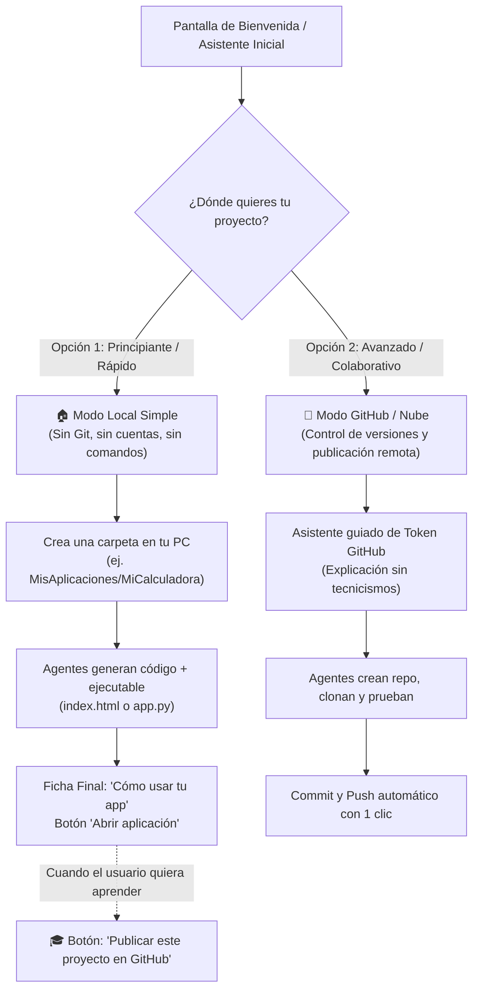

# Especificación y Directiva de Implementación para Codex: UX Intuitiva para No Programadores, Flujo Dual (Local vs. GitHub) y Memoria Asociativa tipo Neuromapa

**Fecha:** 29 de octubre de 2026  
**Rama:** `feature/v0.2.0-madre-continuity`  
**Referencia de Punto Seguro:** `docs/OPERATIONAL-STATUS-2026-10-29.md` (Commit operacional rc2, 909 PASS / 0 FAIL)  
**Objetivo:** Transformar el sistema de una herramienta de nicho para ingenieros de software a una plataforma intuitiva accesible para **usuarios no técnicos**, con separación transparente entre **Modo Local** y **Modo GitHub**, guía ejecutable post-generación ("Qué hacer con tu código"), y optimización de contexto y tokens inspirada en el grafo asociativo de **Neuromapa**.

---

## 1. Contexto Operativo y Diagnóstico de Partida

### 1.1 Estado Actual Comprobado (29-Oct-2026)
- **Flujo E2E validado:** Ejecución real `run-b70e76e5abd6` completada con éxito (`"passed": true`, 0 errores).
- **Par de Modelos Óptimo:** 
  - `Coder`: `Qwen/Qwen2.5-Coder-32B-Instruct:nscale`
  - `Reviewer`: `openai/gpt-oss-120b:nscale` (resuelve el problema de falsos negativos de normalización trigonométrica presentes en modelos Qwen puros como revisores).
- **Normalización de Estilo:** `Ruff I001` aplicado en memoria sobre la propuesta antes de escribir a disco, registrando hashes transparentemente.
- **Suite de Pruebas:** 909 PASS, 4 SKIP, 0 FAIL. Frontend con 32 tests de estados y 14 comprobaciones de paquete portable en verde.
- **Punto Débil Detectado por el Profesor:** La interfaz y los conceptos actuales (`worktree`, `diff unified`, `HEAD`, `pytest.unit`, `Ruff I001`, `hash sha256`, `promover parche`) son **excesivamente técnicos y hostiles** para clientes, emprendedores o estudiantes que piden una aplicación sin saber programar.

---

## 2. Rediseño de Experiencia de Usuario (Feedback del Profesor)

### 2.1 El Problema Fundamental de Usabilidad
El usuario no técnico no quiere "revisar un parche diff" ni sabe qué hacer cuando el sistema dice `promoted`. Quiere saber:
1. **¿Qué construyó el sistema?** (Resumen funcional en lenguaje humano).
2. **¿Dónde está mi aplicación y cómo la abro ya mismo?** (Botón de "Ejecutar / Abrir App" o comando de 1 solo paso).
3. **¿Cómo la comparto o guardo?** (Local en su computadora sin enredos, o subirla a GitHub cuando esté listo).

### 2.2 Separación Estricta: "Modo Local Simple" vs. "Modo GitHub / Nube"



#### Reglas de Diseño del Modo Local:
- **Cero jerga Git obligatoria:** En lugar de exigir un repositorio con commit `HEAD` preexistente, el sistema inicializa internamente un Git invisible o una carpeta directa para rastreo, pero para el usuario es simplemente *"Mi carpeta de aplicación"*.
- **No mostrar diffs crudos por defecto:** Mostrar una vista de **"Archivos Creados"** con iconos amigables y un resumen de lo que hace cada archivo, con una pestaña secundaria *"Ver cambios técnicos (Diff)"* para usuarios avanzados.

#### Reglas de Diseño de la Ficha Post-Generación ("Qué hacer con tu código"):
Al terminar la promoción, en lugar de un frío estado `completed`, el sistema debe desplegar una tarjeta interactiva:
1. **Acción Principal Inmediata:**
   - Si es Web: Botón prominente **"🌐 Abrir en el navegador"** (abre `index.html` o levanta servidor local `http.server` temporal).
   - Si es Python/CLI: Botón **"▶️ Ejecutar aplicación"** o un bloque visual con el comando exacto para copiar y pegar: `python calculadora.py`.
2. **Instrucciones Claras en 3 Pasos:**
   - *"Paso 1: Tu aplicación está guardada en `C:\MisProyectos\Calculadora`"*.
   - *"Paso 2: Requiere Python 3.12 (ya incluido en este sistema)"*.
   - *"Paso 3: Para iniciarla en cualquier momento, abre el archivo `iniciar.bat` generado"*.

#### Asistente de Conexión a GitHub (Pedagógico):
- Si el usuario decide subir a GitHub:
  - Explicar en 2 oraciones qué es GitHub (*"Es como un Google Drive pero especializado en código, donde tu proyecto queda guardado en la nube de forma segura"*).
  - Campo para Personal Access Token (PAT) con botón directo a `github.com/settings/tokens` con los permisos exactos marcados.
  - Botón: **"🚀 Publicar en GitHub ahora"** -> Ejecuta `git remote add`, `git add`, `git commit -m "Mi aplicación inicial construida con AI-SWE"`, `git push`.

---

## 3. Integración de Patrones de `neuromapa` (Memoria Asociativa y Optimización de Tokens)

El repositorio `https://github.com/lumiel777/neuromapa` aporta tres principios arquitectónicos de alto valor para resolver la contención de presupuesto y la ventana de contexto del sistema:

### 3.1 Grafo de Co-ocurrencia de Archivos ("Mielina" de Archivos)
- **Problema actual:** Cuando un repositorio crece, el `Researcher` lee todos los archivos que coinciden con `_EXTENSIONES` o trunca a ciegas. Si enviamos 20 archivos al prompt del `Coder`, se disparan los tokens y el costo, o se satura el modelo.
- **Patrón Neuromapa:** Un grafo en memoria donde los nodos son archivos y las aristas son relaciones observadas:
  - Si un archivo `calculadora.py` importa `operaciones.py` y ambos son probados por `test_calculadora.py`, el peso de co-ocurrencia entre ellos aumenta.
  - **Poda Asociativa:** Al recibir una instrucción, el `Researcher` identifica el archivo semilla (por mención o búsqueda de términos) y recorre el grafo seleccionando **únicamente el vecindario de mayor peso (Top-K nodos conectados)**.
  - **Resultado:** Reducción del 50% al 70% en tokens de entrada hacia `Qwen2.5-Coder` en proyectos existentes.

### 3.2 Freno Dinámico de Tokens y Alerta de Velocidad Horaria
- **Patrón Neuromapa:** `config.json` con umbral de gasto por hora (`max_tokens_per_hour` o `max_usd_per_hour`).
- Si en una ráfaga de reintentos los agentes superan el límite horario, el sistema entra en una pausa preventiva (*"Has consumido $0.50 USD en los últimos 30 minutos. ¿Deseas autorizar la siguiente ronda de pruebas?"*).
- Esto evita drenar los créditos API por bucles inadvertidos de reintentos entre `Coder` y `Reviewer`.

### 3.3 Detección de Archivos Huérfanos y Contexto Redundante
- Limpieza previa antes de alimentar al LLM: eliminar comentarios masivos repetidos, archivos de lock (`package-lock.json`), assets binarios o temporales de cache (`.pytest_cache`, `__pycache__`) antes de calcular la evidencia.

---

## 4. Tareas Específicas de Implementación para Codex

### Tarea 1: Backend — Servicio de Guía de Ejecución y Publicación GitHub
1. **Endpoint `GET /runs/{run_id}/launch-guide`:**
   - Detecta la naturaleza de los archivos promovidos:
     - Si hay `.html`: Tipo `web_static` -> URL `file:///...` o comando `python -m http.server`.
     - Si hay archivo principal Python (`main.py`, `app.py`, o archivo homónimo al proyecto): Tipo `python_app` -> comando de ejecución.
   - Genera automáticamente un archivo lanzador en Windows: `iniciar.bat` o `ejecutar.cmd` dentro del proyecto.
   - Devuelve JSON estructurado:
     ```json
     {
       "app_type": "web" | "cli" | "service",
       "summary_es": "Calculadora con funciones trigonométricas en Python y web",
       "main_file": "index.html",
       "launch_action": "open_browser" | "run_command",
       "command": "python app.py",
       "instructions": [
         "Haz doble clic en iniciar.bat en la carpeta de tu proyecto",
         "Se abrirá la aplicación en tu navegador",
         "Para detenerla, cierra la ventana negra de la terminal"
       ]
     }
     ```
2. **Endpoint `POST /projects/{project_id}/publish-github`:**
   - Contrato: `GitHubPublishRequest(repo_name: str, pat_token: SecretStr, private: bool = True)`.
   - Crea el repositorio en GitHub vía API REST de GitHub (`POST /user/repos`), configura el origen remoto seguro (`origin`) con credencial temporal en memoria (redactada de logs), y ejecuta `git push -u origin HEAD`.

### Tarea 2: Backend — Gestor de Memoria Asociativa (`src/ai_swe/state/memory_graph.py`)
1. Implementar `FileMemoryGraph` en SQLite usando una tabla de adyacencia `file_cooccurrence(source TEXT, target TEXT, weight REAL, last_seen DATETIME)`.
2. Al ejecutar `researcher` o `apply_sandbox`, actualizar las aristas entre los archivos modificados/leídos juntos.
3. Filtrar la evidencia entregada al Coder priorizando los nodos de mayor peso relativo al requerimiento del usuario.

### Tarea 3: Frontend — Rediseño de Vista General y Ficha Post-Promoción
1. **Paso Inicial en `Compositor.tsx`:** Selector visual claro:
   - 🔘 **"Modo Local"** *(Recomendado para no programadores: guarda en una carpeta de tu equipo sin necesidad de cuentas ni Git)*.
   - 🔘 **"Modo GitHub"** *(Para desarrolladores o usuarios que deseen sincronizar con un repositorio remoto)*.
2. **Componente `GuiaEjecucion.tsx`:**
   - Aparece automáticamente cuando `run.status === "completed"`.
   - Tarjeta verde brillante con icono de cohete: *"¡Tu aplicación está lista para usar!"*.
   - Botón directo para abrir la app o copiar el comando.
   - Botón secundario: *"🚀 Publicar en GitHub"* que abre el modal pedagógico de publicación.
3. **Modal `PublicarGitHubModal.tsx`:**
   - Explicación sencilla paso a paso con enlace para generar el token en GitHub en 1 clic.

---

## 5. Criterios de Aceptación y Pruebas Verificables

1. **Test Automatizado de Guía de Lanzamiento (`tests/test_launch_guide.py`):**
   - Verificar que para un proyecto con `index.html` devuelva `open_browser` y cree `iniciar.bat`.
   - Verificar que para un proyecto con `calculadora.py` devuelva `run_command` y el comando de arranque correcto.
2. **Test de Memoria Asociativa (`tests/test_memory_graph.py`):**
   - Verificar que archivos que se modifican juntos aumentan su peso de adyacencia y son priorizados en la poda de contexto.
3. **Smoke Test de Frontend y Build:**
   - `tsc --noEmit && vite build` sin errores de compilación.
   - Suite `frontend/tests/estados.test.mjs` con 100% PASS.
4. **Preservación Presupuestaria:**
   - Mantener el libro mayor monotónico sin exceder los techos de gasto autorizados.
