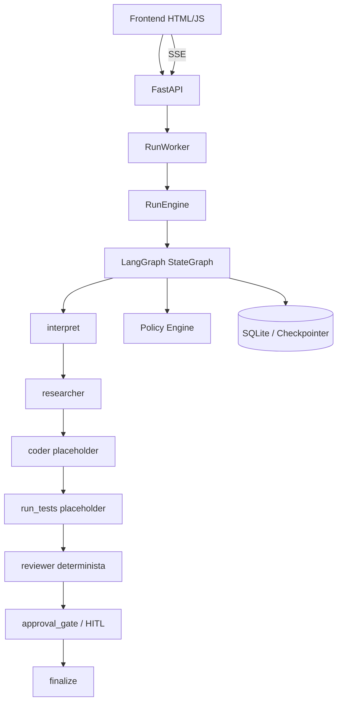

> **Procedencia.** Documento del conjunto `AI_SWE_documentacion_actualizada`,
> derivado de la auditoría técnica externa del 2026-10-06.
> Estado: **VIGENTE**. Integrado sin modificar su contenido técnico;
> solo se añadió esta cabecera. Ver `_PROCEDENCIA.txt`.

# 02 — Arquitectura actual

## Decisiones a conservar
- LangGraph como orquestador.
- `RunState` tipado.
- Comunicación entre nodos por contratos, no por chat global.
- HITL real.
- Policy Engine determinista.
- Persistencia y eventos.
- Regla de no fabricar evidencia.
