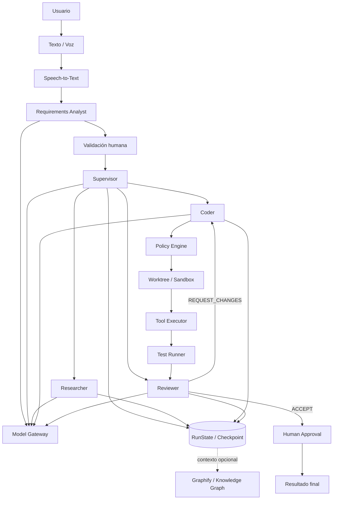

> **Procedencia.** Documento del conjunto `AI_SWE_documentacion_actualizada`,
> derivado de la auditoría técnica externa del 2026-10-06.
> Estado: **VIGENTE**. Integrado sin modificar su contenido técnico;
> solo se añadió esta cabecera. Ver `_PROCEDENCIA.txt`.

# 03 — Arquitectura objetivo

Graphify y MCP no son requisitos del MVP M2. Se integran después de demostrar el flujo principal.
